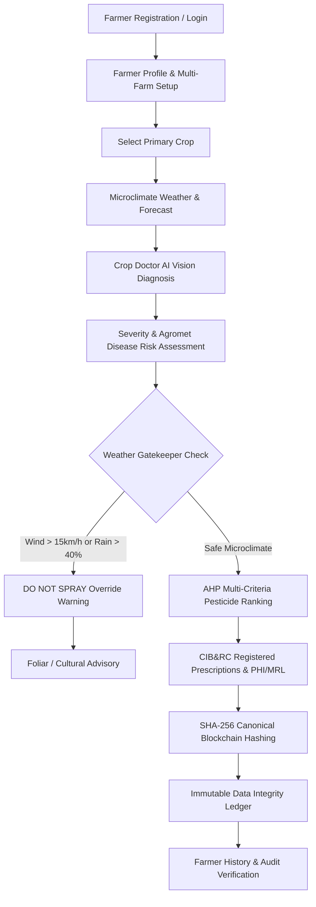

# 🌱 AgriIntel — Precision Agriculture AI Decision Intelligence Engine

[](https://fastapi.tiangolo.com)
[](https://flutter.dev)
[](https://python.org)
[-green.svg)]()
[]()
[]()

**AgriIntel** is an enterprise-grade Precision Agriculture Decision Intelligence System designed for smallholder and commercial farmers in Maharashtra, India. It combines **microclimate agrometeorological forecasting**, **computer vision leaf disease diagnosis**, **rule-based spray safety gatekeeping**, **Analytic Hierarchy Process (AHP) pesticide ranking**, and **cryptographic SHA-256 data integrity ledgers** into a unified, accessible interface.

---

## 🌾 Supported Primary Crops

AgriIntel is engineered with strict domain authority for **4 primary crops**, designed for future multi-crop extensibility:

| Crop | Scientific Name | Marathi | Authoritative Scientific Research Authority |
| :--- | :--- | :--- | :--- |
| **Onion** | *Allium cepa* | कांदा | ICAR - Directorate of Onion and Garlic Research (DOGR), Rajgurunagar |
| **Grapes** | *Vitis vinifera* | द्राक्षे | ICAR - National Research Centre for Grapes (NRCG), Pune |
| **Sugarcane** | *Saccharum officinarum* | ऊस | ICAR - Sugarcane Breeding Institute (SBI), Coimbatore & VSI Pune |
| **Wheat** | *Triticum aestivum* | गहू | ICAR - Indian Institute of Wheat and Barley Research (IIWBR), Karnal |

---

## ⚡ Key Modules & Features (Steps 3–9)



### 1. 🔐 Step 3 — Authentication & Multi-Farm Profiles
- **Farmer Onboarding**: Registration $\to$ Profile Creation $\to$ Farm Details $\to$ Crop Selection $\to$ Dashboard.
- **Data Model**: Multi-farm architecture capturing latitude/longitude, acreage, soil types, and irrigation methods (Drip, Sprinkler, Flood).
- **Localization**: Full support for English, Marathi (मराठी), and Hindi (हिंदी).

### 2. 📚 Step 4 — Authoritative Agricultural Data Layer
- Structured datasets for growth stages, disease etiology, symptoms, and agromet rules.
- **Data Safety Mandate**: Every agricultural recommendation explicitly carries an authoritative `source` tag and `verification_status` (`VERIFIED` vs `DEMO`).

### 3. ⛅ Step 5 — Weather API & Spray Gatekeeper
- **OpenWeather Integration**: Microclimate weather proxy with 24-hour hourly and 5-day daily agromet forecasts.
- **Configurable Rule Engine**: Evaluates wind velocity ($>15\text{ km/h}$ drift hazard), rain probability ($>40\%$), relative humidity, and temperature.
- **Decisions**: `GOOD_TO_SPRAY`, `CAUTION`, `DO_NOT_SPRAY` with transparent agronomic justifications.

### 4. 🔬 Step 6 — Crop Doctor & ML Plant Vision
- Leaf photo capture/upload with input MIME, size, and corruption validation.
- Deep learning vision pipeline predicting pathogen classification, confidence score, canopy severity, and agromet disease risk.
- Traceable model registry in `models/model_versions.csv`.

### 5. 🧪 Step 7 — Pesticide Recommendation & AHP Engine
- **Analytic Hierarchy Process (AHP)**: Pairwise comparison matrices computing priority weights across:
  - Problem Relevance ($35\%$)
  - Crop Compatibility ($25\%$)
  - Weather Suitability ($20\%$)
  - Source Verification ($10\%$)
  - Safety & PHI / MRL Compliance ($10\%$)
- **Consistency Ratio Guarantee**: Mathematical validation ensuring $CR < 0.10$.
- **Weather Gatekeeper Priority Override**: Safety alert enforces priority when spraying conditions are hazardous.

### 6. 🔄 Step 8 — Verified ETL Data Pipeline
- Modular pipeline (`etl/extract.py`, `etl/transform.py`, `etl/validate.py`, `etl/normalize.py`, `etl/load.py`, `etl/pipeline.py`).
- Cleanses, deduplicates, and compiles authoritative raw datasets into `data/master_dataset.csv`.

### 7. ⛓️ Step 9 — Cryptographic Blockchain Data Integrity
- Canonical SHA-256 block hashing of every diagnosis, advisory, and recommendation.
- Immutable provenance ledger in `data/blockchain_records.csv` linked back to Genesis Block `blk_000`.
- Real-time verification endpoint `/blockchain/verify/{record_id}` with an interactive Flutter verification modal.

---

## 📁 Repository Structure

```text
AgriIntel/
├── backend/                  # FastAPI Python Backend
│   ├── app/
│   │   ├── ahp/              # AHP Decision Engine & Pairwise Matrices
│   │   ├── blockchain/       # SHA-256 Tamper-Evident Ledger
│   │   ├── core/             # Settings, Config & .env loader
│   │   ├── ml/               # Vision inference & Disease models
│   │   ├── models/           # Pydantic Schemas & Data Contracts
│   │   ├── routers/          # API Endpoints (Auth, Crops, Weather, Crop Doctor, AHP, etc.)
│   │   └── main.py           # FastAPI Application Root
│   ├── run.py                # Backend Uvicorn Server Starter
│   └── test_api_endpoints.py # Automated Test Suite
├── data/                     # Authoritative Agricultural Data Layer
│   ├── crops.csv             # 4 Primary Crops Registry
│   ├── crop_stages.csv       # Phenological Growth Stages
│   ├── diseases.csv          # Plant Pathology Profiles
│   ├── disease_risk_rules.csv# Agrometeorological Risk Rules
│   ├── pesticides.csv        # CIB&RC Registered Fungicides & PHI/MRL
│   ├── ahp_criteria.csv      # Multi-Criteria Decision Weights
│   ├── ahp_scores.csv        # Compiled AHP Weights
│   ├── sources.csv           # Authoritative Scientific Registry
│   ├── master_dataset.csv    # Master ETL Compiled Dataset
│   └── blockchain_records.csv# SHA-256 Blockchain Ledger
├── etl/                      # End-to-End ETL Pipeline
│   ├── extract.py            # CSV/API Data Extractor
│   ├── transform.py          # Data Transformer
│   ├── validate.py           # Schema & Crop Validator
│   ├── normalize.py          # Data Normalizer
│   ├── load.py               # Dataset Loader
│   └── pipeline.py           # ETL Pipeline Orchestrator
├── frontend/                 # Flutter Cross-Platform Application
│   ├── lib/
│   │   ├── models/           # Dart Data Models
│   │   ├── providers/        # State Management (AppState)
│   │   ├── screens/          # UI Screens (Login, Register, Home, Weather, Crop Doctor, etc.)
│   │   ├── services/         # REST Client (ApiService)
│   │   ├── theme/            # Agro-Themed UI Design System
│   │   └── main.dart         # Flutter App Entrypoint
│   └── pubspec.yaml          # Flutter Dependencies
├── models/                   # ML Models & Versioning
│   └── model_versions.csv    # Model Version Tracker
├── .env                      # Environment Variables (OpenWeather API key)
└── README.md                 # Documentation
```

---

## 🚀 Quick Start Guide (VS Code)

### Prerequisites
- **Python 3.10+** (FastAPI, Uvicorn, Pydantic, NumPy, Requests)
- **Flutter SDK 3.20+** & Dart
- **Google Chrome** or Windows Desktop build tools

---

### Step 1: Start the Backend Server

Open a terminal in VS Code (`Ctrl + ~`):

```powershell
python backend/run.py
```

* **Health Endpoint:** [http://127.0.0.1:8000/health](http://127.0.0.1:8000/health)
* **Interactive API Documentation (Swagger UI):** [http://127.0.0.1:8000/docs](http://127.0.0.1:8000/docs)

---

### Step 2: Launch the Flutter Frontend

Open a second terminal in VS Code (`+` button in terminal panel):

```powershell
cd frontend
flutter run -d chrome
```

> **Alternative Platforms:**
> - Windows Desktop: `flutter run -d windows`
> - Android Phone / Emulator: `flutter run`

---

### Step 3: Run the ETL Pipeline & Test Suites

```powershell
# 1. Execute the ETL Pipeline
python -m etl.pipeline

# 2. Run Backend Automated Test Suite (21 Tests)
python backend/test_api_endpoints.py

# 3. Verify Flutter Code Integrity
cd frontend
flutter analyze
```

---

## 🔑 Demo Access Credentials

| Field | Demo Account |
| :--- | :--- |
| **Mobile Number** | `9876543210` |
| **Password** | `demo_password` |
| **Farmer Name** | Pranali Patil (Junnar, Pune) |
| **Quick Access** | Tap **"Quick Demo Login"** on the Sign-In screen |

---

## 📡 Core API Reference

| Method | Endpoint | Description |
| :--- | :--- | :--- |
| `GET` | `/health` | System health check and core crop capability |
| `POST` | `/api/auth/register` | Register farmer with multi-farm parameters |
| `POST` | `/api/auth/login` | Sign in with mobile/email and password |
| `GET` | `/api/auth/profile` | Retrieve profile and registered farms |
| `PUT` | `/api/auth/crops` | Update cultivated primary crops |
| `GET` | `/api/crops` | List strictly the 4 supported primary crops |
| `GET` | `/api/crops/{crop_id}` | Fetch detailed scientific crop profile |
| `GET` | `/api/weather` | Microclimate forecast with Spray Gatekeeper status |
| `POST` | `/api/weather-gatekeeper` | Rule-based spray suitability evaluator |
| `POST` | `/api/crop-doctor/diagnose` | ML leaf vision diagnosis & agromet risk |
| `POST` | `/api/recommend` | AHP multi-criteria pesticide ranking |
| `POST` | `/api/ahp/evaluate` | AHP crop planning consistency evaluation |
| `GET` | `/api/advisories` | Active agronomic stage advisories |
| `GET` | `/api/pesticides` | CIB&RC registered pesticide registry |
| `GET` | `/api/history` | Farmer consultation and diagnosis history |
| `POST` | `/api/chat` | AI agronomy chat assistant |
| `GET` | `/api/blockchain/verify/{id}` | Cryptographic SHA-256 record verification |

---

## 🏛️ Authoritative Scientific Data Sources

AgriIntel data is curated directly from statutory and government research authorities:
- **ICAR - National Research Centre for Grapes (NRCG), Pune**
- **ICAR - Directorate of Onion and Garlic Research (DOGR), Rajgurunagar**
- **ICAR - Sugarcane Breeding Institute (SBI), Coimbatore & VSI Pune**
- **ICAR - Indian Institute of Wheat and Barley Research (IIWBR), Karnal**
- **Central Insecticides Board & Registration Committee (CIB&RC / PPQS)**
- **India Meteorological Department (IMD)**
- **Maharashtra State Agriculture Department**

---

## ⚖️ Disclaimer

*AgriIntel provides advisory precision decision support based on agrometeorological rules, machine learning diagnostics, and CIB&RC label claims. Field decisions should always adhere to official statutory pesticide labels, local Krishi Vigyan Kendra (KVK) guidance, and environmental safety regulations.*
# AgriIntel

# AgriIntel

