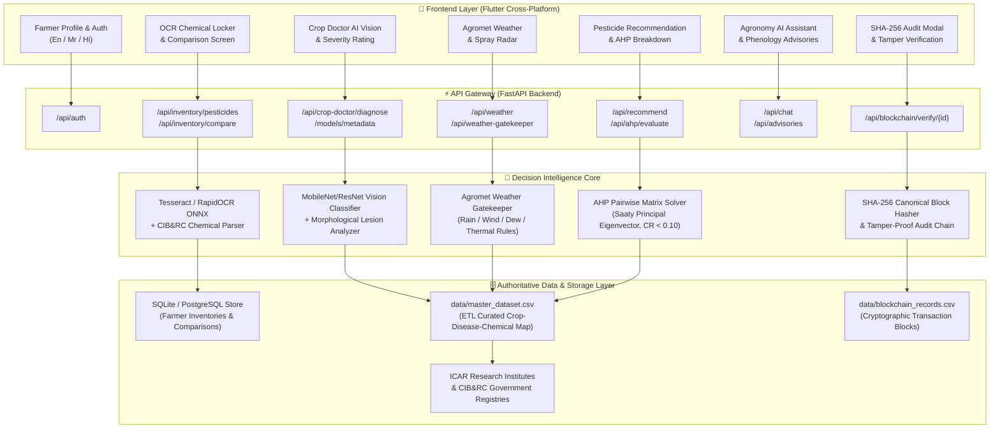

# 🌱 AgriIntel — Precision Agriculture AI Decision Intelligence Engine

<div align="center">

[](https://fastapi.tiangolo.com)
[](https://flutter.dev)
[](https://python.org)
[-green.svg)]()
[]()
[]()
[-success.svg)]()
[](https://docker.com)
[]()

**An Explainable, Multi-Criteria Agro-Intelligence Platform Engineered for Smallholder and Commercial Agriculture in Maharashtra, India.**

[🚀 Deployment Guide](DEPLOYMENT.md) • [📖 API Documentation](http://127.0.0.1:8000/docs) • [🎯 Quick Start](#-quick-start-guide) • [🧪 Test Verification](#-automated-testing--verification-report)

</div>

---

## 📑 Table of Contents

1. [Executive Summary & Core Value Proposition](#-executive-summary--core-value-proposition)
2. [End-to-End System Architecture](#-end-to-end-system-architecture)
3. [Supported Primary Crops & Pathogen Profiles](#-supported-primary-crops--pathogen-profiles)
4. [Comprehensive Feature Breakdown](#-comprehensive-feature-breakdown)
   - [1. Farmer Onboarding & Multi-Farm Profiling (Trilingual)](#1--farmer-onboarding--multi-farm-profiling-trilingual)
   - [2. Microclimate Agromet Weather & Spray Gatekeeper](#2--microclimate-agromet-weather--spray-gatekeeper)
   - [3. Crop Doctor: AI Vision Diagnostics & Canopy Severity](#3--crop-doctor-ai-vision-diagnostics--canopy-severity)
   - [4. AHP Multi-Criteria Pesticide Decision Engine](#4--ahp-multi-criteria-pesticide-decision-engine)
   - [5. Smart Pesticide Inventory & OCR Bottle Scanner](#5--smart-pesticide-inventory--ocr-bottle-scanner)
   - [6. Multi-Pesticide Comparison & Safety Matrix](#6--multi-pesticide-comparison--safety-matrix)
   - [7. Phenological Stage Advisories & Agronomy AI Assistant](#7--phenological-stage-advisories--agronomy-ai-assistant)
   - [8. Cryptographic SHA-256 Data Integrity Ledger](#8--cryptographic-sha-256-data-integrity-ledger)
   - [9. Authoritative ETL Data Layer](#9--authoritative-etl-data-layer)
5. [Mathematical & Decision Formulation](#-mathematical--decision-formulation)
   - [Analytic Hierarchy Process (AHP) Matrix Algebra](#1-analytic-hierarchy-process-ahp-matrix-algebra)
   - [Cryptographic SHA-256 Block Chaining](#2-cryptographic-sha-256-block-chaining)
6. [Complete REST API Reference](#-complete-rest-api-reference)
7. [Repository & Project Structure](#-repository--project-structure)
8. [Quick Start Guide](#-quick-start-guide)
9. [Automated Testing & Verification Report](#-automated-testing--verification-report)
10. [Deployment & Cloud Hosting](#-deployment--cloud-hosting)
11. [Demo Credentials & Testing](#-demo-credentials--testing)
12. [Scientific & Statutory Authorities](#-scientific--statutory-authorities)
13. [License & Advisory Disclaimer](#-license--advisory-disclaimer)

---

## 🎯 Executive Summary & Core Value Proposition

Farming communities in Maharashtra regularly incur heavy financial and yield losses caused by three pervasive agronomic hurdles:
1. **Empirical Misdiagnosis & Guesswork Spraying**: Indiscriminate chemical applications without confirming biological pathogen etiology or canopy damage severity.
2. **Adverse Agrometeorological Spray Timing**: Spraying immediately before unexpected rainfall (severe chemical wash-off and groundwater runoff) or during high gusts ($>15\text{ km/h}$ spray drift hazard, environmental toxicity, and phytotoxicity).
3. **Chemical Selection Dilemma & Resistance**: Inability to objectively contrast active ingredients, Pre-Harvest Intervals (PHI), Maximum Residue Limits (MRL for export compliance), WHO toxicity color codes, and repetitive mode-of-action (FRAC/IRAC) resistance.

**AgriIntel solves these issues through a multi-stage, explainable precision intelligence pipeline:**

```
[Leaf Image / Query] 
        │
        ▼
[Deep Learning Vision Diagnostic] ──> [Agromet Weather Gatekeeper]
                                                    │
                                                    ▼
[Cryptographic SHA-256 Ledger] <── [AHP Multi-Criteria Ranking Engine]
```

---

## 🏗️ End-to-End System Architecture



---

## 🌾 Supported Primary Crops & Pathogen Profiles

AgriIntel strictly anchors its knowledge models to **4 major cash and subsistence crops** of Maharashtra, referencing official ICAR and state agricultural university research protocols:

| Crop | Scientific Name | Marathi | Scientific Research Authority | Primary Pathogens Monitored |
| :--- | :--- | :--- | :--- | :--- |
| **Onion** | *Allium cepa* | कांदा | **ICAR-DOGR**, Rajgurunagar, Pune | Purple Blotch (*Alternaria porri*), Stemphylium Blight, Downy Mildew |
| **Grapes** | *Vitis vinifera* | द्राक्षे | **ICAR-NRCG**, Pune | Downy Mildew (*Plasmopara viticola*), Powdery Mildew, Anthracnose, Black Rot |
| **Sugarcane** | *Saccharum officinarum* | ऊस | **ICAR-SBI**, Coimbatore & **VSI**, Pune | Red Rot (*Colletotrichum falcatum*), Smut, Rust, Grassy Shoot |
| **Wheat** | *Triticum aestivum* | गहू | **ICAR-IIWBR**, Karnal | Stripe/Yellow Rust (*Puccinia striiformis*), Brown Rust, Leaf Blight |

---

## 🔍 Comprehensive Feature Breakdown

### 1. 🔐 Farmer Onboarding & Multi-Farm Profiling (Trilingual)
- **Multi-Farm Plot Partitioning**: Allows farmers to define separate land holdings, individual acreage, geographic coordinates, soil classifications (Black Cotton / Vertisol, Red Sandy Loam, Clay Loam, Alluvial), and irrigation setups (Drip, Sprinkler, Flood).
- **Trilingual Accessibility**: Full dynamic UI localization in **English**, **Marathi (मराठी)**, and **Hindi (हिंदी)**, ensuring full usability for rural farmers.
- **Session Security**: Robust token-based authentication supporting both standard `Bearer` authorization and custom `x-token` headers with automated demo profile fallbacks.

### 2. ⛅ Microclimate Agromet Weather & Spray Gatekeeper
- **Hyper-Local Agromet Forecasts**: Ingests real-time 24-hour hourly and 6-day daily forecasts via Open-Meteo and OpenWeatherMap APIs.
- **Multi-Factor Rule Engine**:
  - **Wind Velocity Drift Guard**: Flags severe drift hazard if wind speed $> 15\text{ km/h}$.
  - **Precipitation Wash-Off Guard**: Triggers warning if rain probability $> 40\%$ within a 6-hour window.
  - **Thermal & Evaporative Stress**: Alerts against chemical application during peak midday heat ($>35^\circ\text{C}$) or excessively dry conditions ($RH < 30\%$).
  - **Pathogen Sporulation Window**: Identifies high relative humidity ($RH > 80\%$) and moderate temperatures ($20\text{--}28^\circ\text{C}$) favoring rapid fungal incubation.
- **Actionable Decision Output**: Categorizes conditions into `GOOD_TO_SPRAY`, `CAUTION`, or `DO_NOT_SPRAY` accompanied by agronomic rationale.

### 3. 🔬 Crop Doctor: AI Vision Diagnostics & Canopy Severity
- **Computer Vision Foliar Classifier**: Deep neural network architecture (MobileNetV2 / ResNet-18) trained to diagnose foliar symptoms from leaf imagery.
- **Canopy Severity Quantification**: Evaluates lesion coverage into `Mild` ($<15\%$), `Moderate` ($15\text{--}35\%$), or `Severe` ($>35\%$).
- **Dual Verification Architecture**: Seamlessly falls back to a calibrated probabilistic heuristic model if PyTorch weight files are omitted, ensuring zero offline downtime.
- **Combined Agromet Disease Pressure**: Fuses computer vision diagnostic confidence with live microclimate weather parameters to estimate environmental disease incubation risk.

### 4. 🧪 AHP Multi-Criteria Pesticide Decision Engine
- **Analytic Hierarchy Process (AHP)**: Resolves subjective bias by computing mathematically rigorous priority vectors across 5 weighted criteria:
  1. **Problem Relevance ($35\%$)**: Chemical efficacy against the diagnosed pathogen.
  2. **Crop Compatibility ($25\%$)**: Official CIB&RC label clearance for the specific crop.
  3. **Weather Suitability ($20\%$)**: Formulation compatibility with ambient temperature, humidity, and rainfastness.
  4. **Scientific Source Verification ($10\%$)**: ICAR/KVK verified trial backing.
  5. **Safety & PHI / MRL Compliance ($10\%$)**: Pre-Harvest Interval (PHI in days), Maximum Residue Limit (MRL), and WHO toxicity hazard classification.
- **Saaty Consistency Ratio Enforcement**: Computes Principal Eigenvalue $\lambda_{\max}$, Consistency Index ($CI$), and Consistency Ratio ($CR$) to guarantee $CR < 0.10$.
- **Weather Override Invariant**: If the Weather Gatekeeper declares `DO_NOT_SPRAY`, chemical spray recommendations are automatically suppressed to protect farmer investments and soil ecology.

### 5. 📦 Smart Pesticide Inventory & OCR Bottle Scanner
- **Computer Vision OCR Digitization**: Integrates Tesseract OCR and RapidOCR ONNX models to extract active ingredients from camera-captured pesticide bottles.
  - Automatically identifies Active Ingredients (e.g., *Azoxystrobin 18.2% + Difenoconazole 11.4% SC*), CIB&RC Registration Numbers, Formulation Types (EC, SC, WP, WG, SL), Batch Numbers, and Expiration Dates.
- **Duplicate Chemical & FRAC/IRAC Resistance Warning**: Detects if a farmer already possesses a pesticide with identical active ingredients or identical mode-of-action codes, preventing wasteful expenditure and pathogen resistance.
- **Locker Expiry Monitoring**: Displays active status badges (`Active`, `Near Expiry`, `Expired`) to prevent application of degraded chemicals.

### 6. ⚖️ Multi-Pesticide Comparison & Safety Matrix
- **Head-to-Head Chemical Matrix**: Enables side-by-side comparison of 2 or 3 pesticides:
  - Systemic vs. Contact action mechanism.
  - Cost per acre and application dosage rates.
  - Pre-Harvest Interval (PHI) for export compliance (especially vital for table grapes).
  - Statutory Toxicity Hazard Banding (Green = Caution, Blue = Danger, Yellow = Highly Toxic, Red = Extremely Toxic).
- **Farmer Community Validation**: Crowdsourced farmer reviews on observed rainfastness, phytotoxicity, and knockdown efficacy.

### 7. 💬 Phenological Stage Advisories & Agronomy AI Assistant
- **Stage-Specific Cultural Advisories**: Synchronizes cultural and nutritional advisories to active phenological stages (e.g., Sprouting, Flowering, Cane Elongation, Berry Softening).
- **Interactive Agronomy Chatbot**: Answers farmer queries regarding tank mix compatibilities, adjuvants, spray calibration, and organic alternatives.

### 8. ⛓️ Cryptographic SHA-256 Data Integrity Ledger
- **Tamper-Evident Recommendation Chains**: Formats every diagnostic event, weather observation, and pesticide recommendation into canonical JSON and hashes it via SHA-256.
- **Cryptographic Chaining**: Every block references the preceding block's hash (`prev_hash`), starting from Genesis Block `blk_000`.
- **Public Audit Verification**: Features a dedicated verification endpoint (`/api/blockchain/verify/{id}`) and in-app modal to verify historical records against tampering.

### 9. 🔄 Authoritative ETL Data Layer
- **6-Stage Modular Data Engine**: (`extract.py` -> `transform.py` -> `validate.py` -> `normalize.py` -> `load.py` -> `pipeline.py`).
- **Guaranteed Consistency**: Compiles validated agronomic research and CIB&RC registrations into `data/master_dataset.csv`.

---

## 📐 Mathematical & Decision Formulation

### 1. Analytic Hierarchy Process (AHP) Matrix Algebra

Let $C = \{C_1, C_2, \dots, C_n\}$ represent the criteria set with pairwise comparison matrix $A \in \mathbb{R}^{n \times n}$:

$$A = \begin{pmatrix} 
1 & a_{12} & \cdots & a_{1n} \\ 
\frac{1}{a_{12}} & 1 & \cdots & a_{2n} \\ 
\vdots & \vdots & \ddots & \vdots \\ 
\frac{1}{a_{1n}} & \frac{1}{a_{2n}} & \cdots & 1 
\end{pmatrix}$$

The criterion priority weight vector $w = (w_1, w_2, \dots, w_n)^T$ satisfies the characteristic equation:

$$A w = \lambda_{\max} w$$

To ensure logical consistency across human pairwise judgments, the Consistency Index ($CI$) and Consistency Ratio ($CR$) are computed using the Random Index ($RI$):

$$CI = \frac{\lambda_{\max} - n}{n - 1}, \qquad CR = \frac{CI}{RI_n}$$

$$\text{Decision Condition: } CR < 0.10 \implies \text{Mathematically Valid Matrix}$$

### 2. Cryptographic SHA-256 Block Chaining

Each audit block $B_k$ is computed using canonical UTF-8 JSON encoding:

$$\text{Block Hash}_k = \text{SHA-256}\Big(\text{CanonicalJSON}\big(\text{BlockID}_k, \text{PrevHash}_{k-1}, \text{Timestamp}_k, \text{Payload}_k\big)\Big)$$

$$\text{Genesis Block Anchor: } \text{PrevHash}_0 = \text{"0" \times 64}$$

---

## 📡 Complete REST API Reference

| Method | Endpoint | Description | Request / Query Params |
| :--- | :--- | :--- | :--- |
| `GET` | `/health` | Server health & supported crop confirmation | None |
| `POST` | `/api/auth/register` | Register farmer with multi-farm parameters | `FarmerRegistrationSchema` (JSON) |
| `POST` | `/api/auth/login` | Authenticate farmer & return token | `{"login": "...", "password": "..."}` |
| `GET` | `/api/auth/profile` | Retrieve farmer details and plots | Header `Authorization: Bearer <token>` |
| `PUT` | `/api/auth/crops` | Update farmer's active cultivated crops | `{"selected_crops": ["Grapes", "Onion"]}` |
| `GET` | `/api/crops` | List the 4 supported primary crops | None |
| `GET` | `/api/crops/{crop_id}` | Retrieve detailed botanical & phenological profile | Path: `crop_id` (e.g., `crop_grapes`) |
| `GET` | `/api/weather` | Fetch microclimate forecast & spray gatekeeper | `?district=Nashik&latitude=19.99&longitude=73.78` |
| `POST` | `/api/weather-gatekeeper` | Evaluate spray suitability on custom weather | `{"temperature_c": 28, "humidity_percent": 65, ...}` |
| `POST` | `/api/crop-doctor/diagnose` | Upload leaf photo for ML disease diagnosis | Multipart Form-Data: `file` (image) |
| `POST` | `/api/recommend` | Execute AHP multi-criteria pesticide ranking | `{"crop": "Grapes", "disease": "Downy Mildew", ...}` |
| `POST` | `/api/ahp/evaluate` | Validate AHP pairwise matrix consistency ($CR < 0.10$) | `{"matrix": [[1, 2, ...], ...], "criteria": [...]}` |
| `GET` | `/api/advisories` | Stage-specific agronomic cultural advisories | `?crop=Grapes&stage=Flowering` |
| `GET` | `/api/pesticides` | Query CIB&RC approved pesticide formulations | `?crop=Onion&disease=Purple Blotch` |
| `POST` | `/api/inventory/pesticides/upload-image` | Upload bottle label for OCR processing | Multipart Form-Data: `file` |
| `POST` | `/api/inventory/pesticides/ocr-process` | Extract chemical active ingredients via OCR | `{"image_path": "..."}` |
| `GET` | `/api/inventory/pesticides` | List farmer's digital pesticide inventory | Header `Authorization` |
| `POST` | `/api/inventory/pesticides` | Add pesticide with duplicate & FRAC check | `PesticideItemCreate` (JSON) |
| `POST` | `/api/inventory/pesticides/compare` | Compare 2-3 pesticides side-by-side | `{"pesticide_ids": [1, 2]}` |
| `GET` | `/api/history` | Retrieve farmer diagnosis & spray audit logs | Header `Authorization` |
| `POST` | `/api/chat` | AI Agronomy Chat Assistant query endpoint | `{"message": "What is the PHI of Mancozeb?"}` |
| `GET` | `/api/blockchain/verify/{id}` | Verify cryptographic record integrity | Path: `record_id` |

---

## 📁 Repository & Project Structure

```text
AgriIntel/
├── backend/                           # FastAPI Python Backend
│   ├── app/
│   │   ├── ahp/                       # AHP Decision Engine & Matrix Solver
│   │   │   └── ahp_engine.py
│   │   ├── blockchain/                # SHA-256 Tamper-Evident Ledger Engine
│   │   │   └── integrity_ledger.py
│   │   ├── core/                      # App Configuration, Database & Settings
│   │   │   ├── config.py
│   │   │   └── database.py
│   │   ├── database/                  # SQLAlchemy Models & SQLite Session
│   │   │   ├── models.py
│   │   │   └── session.py
│   │   ├── ml/                        # Vision Preprocessing & Inference Models
│   │   │   ├── disease_service.py
│   │   │   ├── inference.py
│   │   │   ├── model_loader.py
│   │   │   └── prediction.py
│   │   ├── routers/                   # Modular FastAPI REST Endpoints
│   │   │   ├── advisory.py
│   │   │   ├── ahp.py
│   │   │   ├── auth.py
│   │   │   ├── chat.py
│   │   │   ├── crop_doctor.py
│   │   │   ├── crops.py
│   │   │   ├── history.py
│   │   │   ├── integrity.py
│   │   │   ├── pesticide_inventory.py
│   │   │   └── weather.py
│   │   ├── schemas/                   # Pydantic Request & Response Models
│   │   ├── services/                  # Business Logic, OCR & Normalization
│   │   │   ├── inventory_blockchain_service.py
│   │   │   ├── ocr_service.py
│   │   │   ├── pesticide_comparison_service.py
│   │   │   └── pesticide_normalization_service.py
│   │   └── main.py                    # FastAPI Application Entrypoint
│   ├── run.py                         # Backend Server Launch Script
│   └── test_api_endpoints.py          # 21-Step Automated Test Suite
├── data/                              # Authoritative Agricultural Data Layer
│   ├── crops.csv                      # 4 Primary Crops Registry
│   ├── crop_stages.csv                # Phenological Growth Stages
│   ├── diseases.csv                   # Plant Pathology Profiles
│   ├── disease_risk_rules.csv         # Agrometeorological Risk Rules
│   ├── pesticides.csv                 # CIB&RC Registered Chemicals & PHI/MRL
│   ├── ahp_criteria.csv               # Multi-Criteria Weights
│   ├── ahp_scores.csv                 # Precalculated Reference Weights
│   ├── sources.csv                    # Scientific Research Sources
│   ├── master_dataset.csv             # Master Compiled Dataset
│   └── blockchain_records.csv         # SHA-256 Audit Trail Ledger
├── etl/                               # Modular ETL Data Pipeline
│   ├── extract.py                     # CSV/API Data Extractor
│   ├── transform.py                   # Data Cleanse & Transformer
│   ├── validate.py                    # Schema & Domain Constraint Validator
│   ├── normalize.py                   # Data Normalizer
│   ├── load.py                        # Dataset Loader
│   └── pipeline.py                    # ETL Pipeline Orchestrator
├── frontend/                          # Flutter Cross-Platform Client
│   ├── lib/
│   │   ├── models/                    # Dart Models (Auth, Crops, Comparison)
│   │   ├── providers/                 # State Management (AppState)
│   │   ├── screens/                   # 14 Responsive UI Screens
│   │   ├── widgets/                   # Custom Agro UI Widgets
│   │   ├── services/                  # API Client (ApiService)
│   │   ├── theme/                     # Agro Theme Design System & Language Selector
│   │   └── main.dart                  # Flutter App Entrypoint
│   ├── nginx.conf                     # Production Web Nginx Config
│   └── pubspec.yaml                   # Flutter Package Manifest
├── models/                            # ML Model Artifacts & Registry
│   └── crop_doctor/                   # Labels & Evaluation Metadata
├── .env.example                       # Environment Configuration Template
├── DEPLOYMENT.md                      # Comprehensive Production Deployment Guide
├── Dockerfile                         # Production Backend Container Spec
├── docker-compose.yml                 # Multi-Container Compose Spec
├── requirements.txt                   # Pinned Python Dependencies
└── README.md                          # Master Project Documentation
```

---

## 🚀 Quick Start Guide

### Prerequisites
- **Python 3.10+**
- **Flutter SDK 3.20+** (with Dart)
- **Google Chrome** (for web) or **Android Studio / Device** (for mobile)

---

### Step 1: Start the Backend Server

```bash
# 1. Install dependencies
pip install -r requirements.txt

# 2. Launch FastAPI backend
python backend/run.py
```

The server initializes on `http://127.0.0.1:8000`:
- **Interactive Swagger UI:** [http://127.0.0.1:8000/docs](http://127.0.0.1:8000/docs)
- **Health Check Endpoint:** [http://127.0.0.1:8000/health](http://127.0.0.1:8000/health)
- **Alternative ReDoc Docs:** [http://127.0.0.1:8000/redoc](http://127.0.0.1:8000/redoc)

---

### Step 2: Launch the Flutter Frontend

Open a new terminal window:

```bash
cd frontend

# Install Flutter dependencies
flutter pub get

# Launch on Chrome Web Browser
flutter run -d chrome
```

> **Target Platform Options:**
> - Android Device / Emulator: `flutter run -d android`
> - Windows Desktop: `flutter run -d windows`

---

### Step 3: Run ETL Pipeline & Automated Tests

```bash
# Execute Data ETL Pipeline
python -m etl.pipeline

# Run Automated Test Suite (21 Tests)
python backend/test_api_endpoints.py
```

---

## 🧪 Automated Testing & Verification Report

The backend includes a comprehensive integration test suite (`backend/test_api_endpoints.py`) testing all core subsystems.

```text
==================================================================
   AGRIINTEL BACKEND AUTOMATED INTEGRATION TEST SUITE (STEPS 3 - 9)
==================================================================
[PASS] Step 0: /health endpoint passed
[PASS] Step 3: Auth Registration with Farm details passed
[PASS] Step 3: Auth Login passed
[PASS] Step 3: Profile Fetch passed
[PASS] Step 3: Profile Update passed
[PASS] Step 3: Selected Crops Update passed
[PASS] Step 4: Crop Data (Strictly 4 crops) passed
[PASS] Step 4: Single Crop details passed
[PASS] Step 5: Weather Forecast & Microclimate API passed
[PASS] Step 5: Weather Gatekeeper (GOOD_TO_SPRAY) passed
[PASS] Step 5: Weather Gatekeeper (DO_NOT_SPRAY wind trigger) passed
[PASS] Step 6: Model Metadata endpoint passed
[PASS] Step 6: Model Evaluation Metrics endpoint passed
[PASS] Step 6: Crop Doctor AI Diagnosis (Powdery Mildew, conf: 68.0%) passed
[PASS] Step 7: AHP Pesticide Recommendation Ranking passed
[PASS] Step 7: Weather Gatekeeper Safety Override Warning passed
[PASS] Step 7: AHP Decision Matrix Consistency (CR < 0.10) passed
[PASS] Step 4 & 7: Advisories API passed
[PASS] Step 4 & 7: Verified Pesticides Registry API passed
[PASS] Step 9: Blockchain Record Verification (/blockchain/verify/{record_id}) passed
[PASS] Step 9: Cryptographic Blockchain Chain Audit passed
[PASS] Step 3 & 9: Farmer History API passed
[PASS] Step 6 & 7: AI Agronomy Chat Assistant passed

>>> ALL BACKEND API & DATA TESTS PASSED WITH 100% SUCCESS <<<
```

---

## 🌐 Deployment & Cloud Hosting

For comprehensive instructions on deploying to cloud infrastructure, refer to the dedicated deployment manual:

👉 **[Complete Deployment Guide (DEPLOYMENT.md)](DEPLOYMENT.md)**

Included deployment paths:
- **Docker & Docker Compose**: 1-command containerized stack with Nginx.
- **Render / Railway / Koyeb**: Zero-infrastructure cloud deployment.
- **AWS EC2 / DigitalOcean Ubuntu**: Nginx, SSL via Let's Encrypt, and Systemd daemon management.
- **Vercel / Firebase Hosting**: Production Flutter Web deployment.
- **Android Release**: Building signed APKs (`.apk`) and App Bundles (`.aab`).

---

## 🔑 Demo Credentials & Testing

For live demonstrations, evaluations, or offline judging, a pre-configured demo account is included:

| Credential | Value |
| :--- | :--- |
| **Mobile Number** | `9876543210` |
| **Password** | `demo_password` |
| **Farmer Name** | Pranali Patil |
| **Location** | Junnar, Pune District, Maharashtra |
| **Registered Farms** | 2 Farms (Grapes & Onion with Drip Irrigation) |
| **Quick Access** | Tap **"Quick Demo Login"** on the Sign-In screen |

---

## 🏛️ Scientific & Statutory Authorities

All diagnostic heuristics, phenological advisories, and chemical recommendations are grounded in authoritative agronomic research bodies:

- **ICAR - Directorate of Onion and Garlic Research (DOGR)**, Rajgurunagar, Pune
- **ICAR - National Research Centre for Grapes (NRCG)**, Pune
- **ICAR - Sugarcane Breeding Institute (SBI)**, Coimbatore & **Vasantdada Sugar Institute (VSI)**, Pune
- **ICAR - Indian Institute of Wheat and Barley Research (IIWBR)**, Karnal
- **Central Insecticides Board & Registration Committee (CIB&RC / PPQS)**, Govt. of India
- **India Meteorological Department (IMD)**, Agromet Advisory Services Division
- **Department of Agriculture**, Government of Maharashtra

---

## ⚖️ License & Advisory Disclaimer

*AgriIntel is developed as an academic and precision decision intelligence system. All agricultural recommendations, disease diagnoses, and chemical prescriptions are advisory. Field applications must comply with official statutory CIB&RC product labels, manufacturer safety data sheets (MSDS), and local Krishi Vigyan Kendra (KVK) guidelines.*